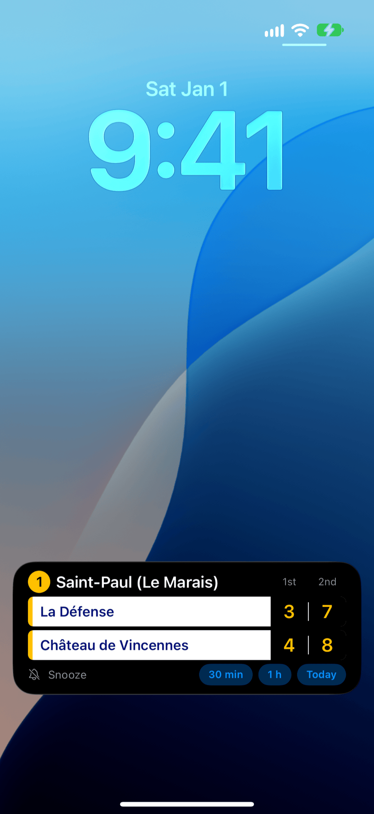

# TROME

### Your next metro, on your lock screen

Walk up to a metro or RER station in the Paris region, and TROME shows its next trains on your iPhone's lock screen, both directions of every line.
It is open source and not on the App Store yet: [follow the launch, or build it yourself](#get-it-on-your-iphone).

  

[Get it](#get-it-on-your-iphone) · [Help](https://valfur03.github.io/trome/en/support/) · [Privacy](https://valfur03.github.io/trome/en/privacy/) · [Read the Swift code](#read-or-change-the-code)

You walk up to Saint-Paul, and your iPhone says **Next trains at Saint-Paul (Le Marais)**.
Tap the notification: the next trains stay on your lock screen while you go down to the platform.
If TROME is already open on your screen, they show with no tap.

- **It comes and goes by itself.** It shows when you are about 150 metres from a station, and it goes away when you walk off.
- **Every line of the station.** At a station with many lines, tap the name of the station to see the next line, metro or RER.
- **Not now?** Snooze it from the lock screen for 30 minutes, an hour, or the rest of the day.
- **Your exact position stays on your iPhone.** No account and no ads: read [what TROME sends, and what it keeps](https://valfur03.github.io/trome/en/privacy/).

## Get it on your iPhone

TROME is for iPhones with iOS 18 or later, and it is not on the App Store yet.
To hear when it is, watch this repo on GitHub: **Watch**, then **Custom**, then **Releases**.

Have a Mac? [Install TROME on your iPhone yourself](https://valfur03.github.io/trome/en/build/install-on-your-iphone/) with Xcode and a free Apple ID: about an hour the first time, and no Xcode experience needed.
You then install it again every 7 days, and you add your own free key from Île-de-France Mobilités for the train times: the guide shows both.

## The trains do not show?

[Help](https://valfur03.github.io/trome/en/support/) lists each problem and its fix: the Live Activity does not show, does not start by itself, or its minutes stop moving.
En français : [Aide](https://valfur03.github.io/trome/fr/support/).

## Read or change the code

The app is written in Swift, with SwiftUI and ActivityKit.
Its train times come from PRIM, the open data API of Île-de-France Mobilités.

- [CONTRIBUTING.md](CONTRIBUTING.md): report a bug, or send your first change.
- [ios/README.md](ios/README.md): build, run and test the iPhone app.
- [server/README.md](server/README.md): the train data server, a Cloudflare Worker.
- [docs/README.md](docs/README.md): the docs site, and how to write a page.

## Licence and data

The code is under the [MIT licence](LICENSE).
The station list and the train times come from Île-de-France Mobilités, and keep their own licences: [NOTICE.md](NOTICE.md) names them, and says what you must do when you reuse them.
TROME is not an app of RATP or of Île-de-France Mobilités.
